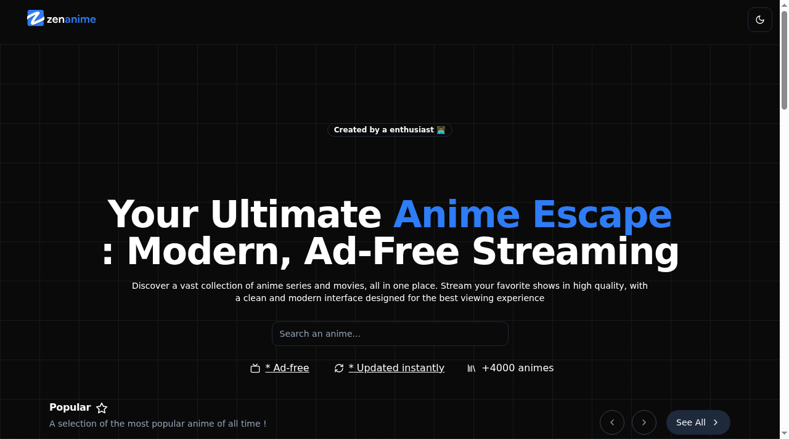
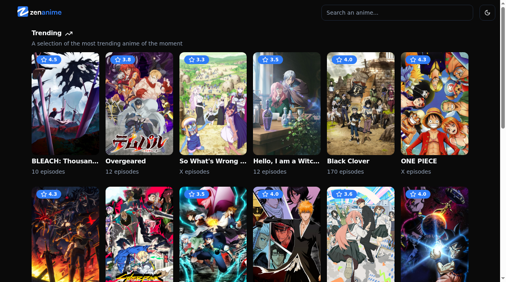
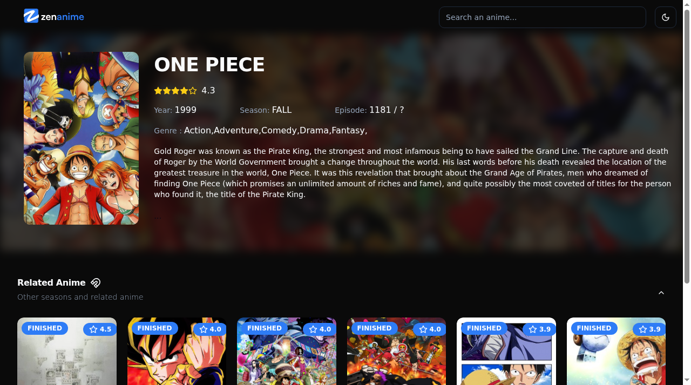
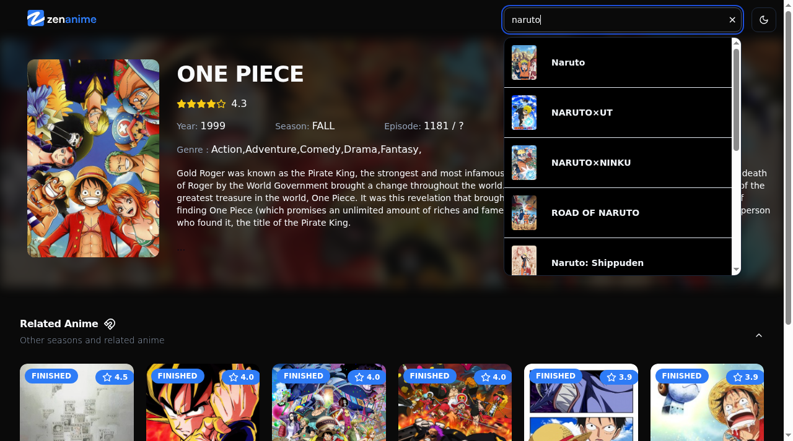

# ZenAnime 📺

> A modern anime discovery web app powered by the AniList GraphQL API.

**Live demo:** [zenanime-topaz.vercel.app](https://zenanime-topaz.vercel.app)

## About

ZenAnime lets you browse, search and explore over 4,000 anime series and movies through a fast, clean, ad-free interface. All data (titles, covers, scores, episodes, trailers) is fetched live from the [AniList API](https://anilist.gitbook.io/anilist-apiv2-docs/) via GraphQL. Built as a front-end project to practice a production-style React + TypeScript setup.

## Features

- **Trending & Popular lists** — carousels and full pages of what's hot right now, with scores, status badges and episode counts
- **Anime detail pages** — synopsis, genres, season, rating, episode progress and related anime (other seasons, spin-offs)
- **Instant search** — live search dropdown with in-memory caching, request cancellation (AbortController) and input sanitization (DOMPurify)
- **Dark / light mode** — theme toggle persisted across sessions
- **Polished UX** — skeleton loaders while data loads, responsive layout from mobile to ultra-wide

## Screenshots

| Home | Trending |
| --- | --- |
|  |  |

| Anime details | Live search |
| --- | --- |
|  |  |

## Tech Stack

- **React 18 + TypeScript + Vite** (SWC)
- **TanStack Router** — file-based, type-safe routing
- **Tailwind CSS + shadcn/ui (Radix UI)** — design system components
- **Axios** — GraphQL queries against the AniList API
- **Swiper, react-player, lucide-react**
- **Vercel Analytics & Speed Insights**

## Getting Started

```bash
git clone https://github.com/Kbelony/ZenAnime.git
cd ZenAnime
npm install
npm run dev
```

Then open http://localhost:5173. No API key needed — the AniList public API is free.

## Project Structure

```
src/
├── components/    # UI components (hero, carousels, search bar, shadcn/ui)
├── lib/anilist.ts # AniList GraphQL queries & types
├── routes/        # TanStack Router file-based routes
└── assets/        # fonts, images, global styles (SCSS)
```
